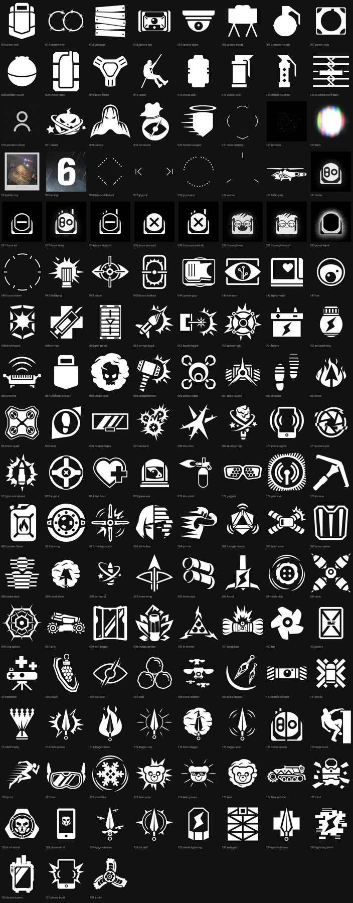
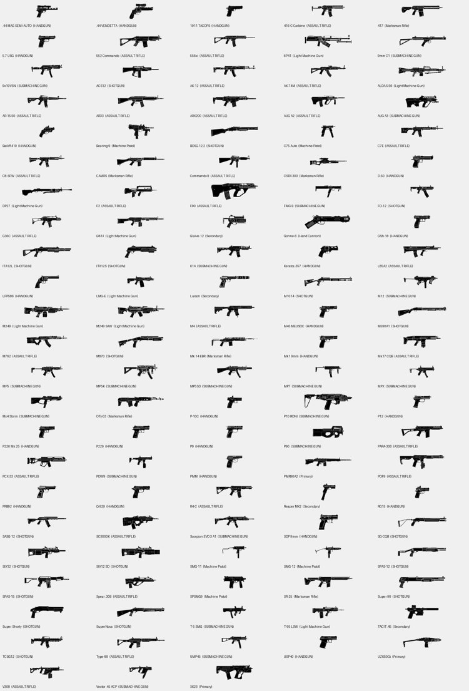

# R6 icons: gadgets and guns

Two icon sets for Rainbow Six Siege. One is taken from the game files, the other from Ubisoft's operator pages. Both are PNG with transparency, sorted into folders, and documented in a CSV so you can trace where every file came from.

Everything here belongs to Ubisoft. This is an unpacking project, not an official asset pack.

## Gadgets



139 icons at 160x160. These are the glyphs the game draws for gadgets, drones, cameras, traps, breach tools and ping markers. They came out of the UI texture archives in the 28 October build (`datapc64_merged_playgo_bnk_guitextures*.forge`).

The icons are white on transparent. On a light background they look blank, so `png-black/` holds the same 139 icons filled near black.

Naming these was the hard part. The game does not store readable names. Each texture is keyed by a 64-bit hash with the name length in front, and the UI data archive contains no strings at all, so there is no lookup table to pull official names from. The names in `gadgets/names.csv` are shape descriptions I wrote by looking at each icon, with a confidence and a note for each one:

- `high` means the shape is unmistakable, like `drone`, `sledgehammer`, `barbed-wire`, `flashbang` or `briefcase-defuser`
- `medium` is a clear shape with a likely meaning, like `camera-tripod` or `wall-breach`
- `low` is a guess, and some of those are HUD chrome rather than gadgets

`gadgets/names.csv` has the file, name, confidence, note, uid, archive container, size and source path. The uid is the asset hash, which is what you want if you need to match an icon back to the game files.

## Guns



113 weapons, named exactly as Ubisoft spells them. `guns/index.csv` lists the name, weapon class, primary or secondary slot, the operators that carry it and the source URL.

These are the same black side-profile glyphs used in the loadout, but they are from the operator pages on ubisoft.com rather than from the game archive. The in-game copies are hashed too, and I could not name them without guessing. Shape matching against the official art topped out around 0.70 IoU, which was not good enough, and wrong guns were winning matches.

`guns/png/` is the original art, `guns/png-white/` is the same alpha filled white for dark backgrounds.

## Scripts

The scripts that produced the two sets are in `scripts/`. Inputs and outputs are passed as arguments, so nothing points at a folder on my machine. The ones that decompress archive chunks need [ooz](https://github.com/powzix/ooz) built first: either put `ooz.exe` in `ooz/` beside `scripts/`, or set `OOZ_EXE` to its full path.

| File | What it does |
| --- | --- |
| `forge_scan.js` | Walks a `.forge` archive and lists its entries |
| `fetch_container.js` | Pulls one entry out of the live process dump |
| `tex.py` | Parses the texture header and decodes BC1, BC3 and BC7 |
| `extract.py` | Batch extracts textures from an archive |
| `export_gadget_set.py` | Picks the 160x160 glyphs, dedupes them and writes the sheet |
| `label_icons.py` | Builds the labelled folder, the black copies and `names.csv` |
| `scrape_weapons.js` | Scrapes weapon blocks from the operator pages |
| `export_guns.py` | Downloads the weapon art and writes the sheets |

The archive chunks are Oodle Kraken compressed. I used [ooz](https://github.com/powzix/ooz) to decompress them, built from source.

```
node scripts/forge_scan.js <file.forge>
node scripts/fetch_container.js <file.forge> <container-offset-hex> <out.bin> <ooz.exe>
py -3 scripts/extract.py <file.forge> <texture-out-dir>
node scripts/scrape_weapons.js <weapon-out-dir>
py -3 scripts/export_guns.py <weapon-out-dir> <icon-out-dir>
py -3 scripts/export_gadget_set.py <out-dir> <sheet.jpg> <size> <extracted-dir> ...
py -3 scripts/label_icons.py <extracted-dir> <labelled-out-dir>
```

`extract.py` writes one `<forge>_index.csv` per archive; `export_gadget_set.py` reads those to find the icons.

## Credits and references

- [RainbowForge](https://github.com/parzivail/RainbowForge) for the Forge container layout and the asset name hash scheme
- [ooz](https://github.com/powzix/ooz) for the Kraken decompressor
- [Ubisoft's operator pages](https://www.ubisoft.com/en-gb/game/rainbow-six/siege/game-info/operators) for the weapon names and art

`references.md` has a longer note on what each one was used for and what did not work.

## Notes

- The gadget set is from one patch. If Ubisoft adds a gadget, its icon will be in a newer archive and this set will be missing it.
- The gun names come from the operator pages, so a weapon added in a season is only here if its operator page existed at scrape time.
- Some gadget names are deliberately generic (`device-lever`, `canister-round`) because the art does not say what the gadget does.
